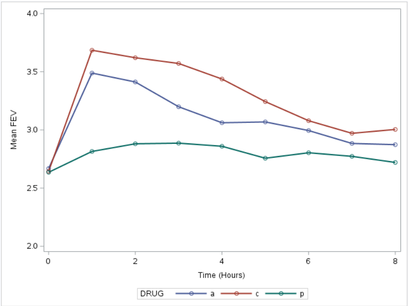
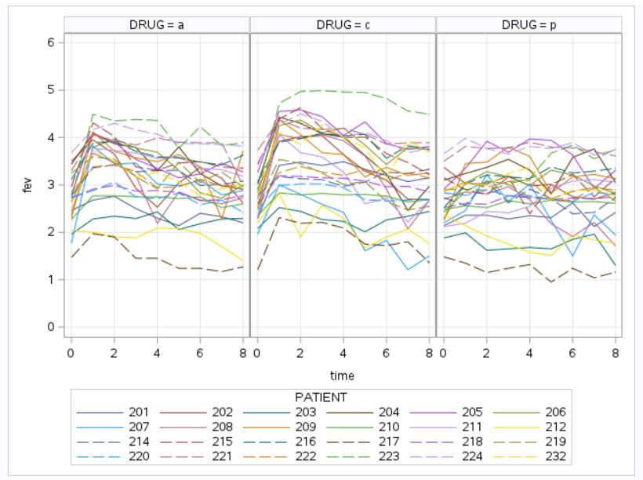
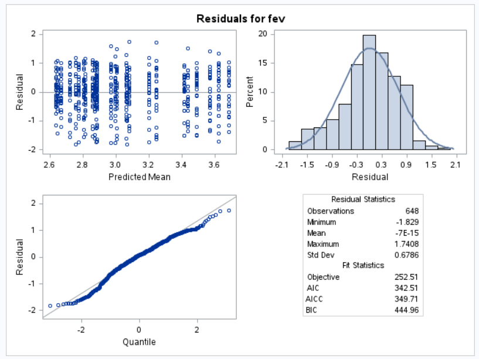

# FEV1 Longitudinal Mixed Model

Longitudinal analysis of forced expiratory volume in one second (FEV1) for patients
in three study arms — drug A, drug C, and placebo — measured at baseline and
1–8 hours after treatment. The analysis compares repeated-measures mixed models,
multilevel (random-coefficients) models, and generalized estimating equations
(GEE), each fitted under several covariance structures.

Course: MATH 6364 Statistical Methods, Fall 2023, University of Texas Rio Grande Valley.

## Key Results

- **Unstructured (UN) covariance wins everywhere.** In the repeated-measures
  mixed model it has the lowest information criteria: **AIC 342.5, AICC 349.7,
  BIC 445.0** (vs. CS: AIC 540.9; AR1: AIC 464.0).
- **Most of the variation is between patients.** The intraclass correlation from
  the unconditional mean model is **ICC ≈ 0.64** — about 64% of the variance in
  FEV1 is between patients, which is why random effects are needed.
- **Drug effects change over time.** In the repeated-measures model, the
  treatment × time interactions are significant (drug A: p = 0.0069; drug C:
  p = 0.0160); the main effects of drug and time alone are not.
- **GEE agrees.** The unstructured working correlation has the lowest QIC
  (**678.05**) of the three GEE fits.

*Mean FEV1 by time for each study arm. Both drug arms rise after treatment and
peak around 2 hours; drug A holds its gain longer, while drug C converges back
toward placebo. Placebo stays comparatively flat.*

## Data

- `data/fev.csv` — long format: 648 observations (24 patients × 3 study arms ×
  9 time points). Columns: `PATIENT`, `BASEFEV`, `fev`, `DRUG`, `time`.
- `data/fev_wide.txt` — the same measurements in wide format (one row per
  patient per arm: baseline FEV1 and FEV1 at hours 1–8).
- `data/FEV.sas7bdat` — the dataset as a SAS data file.

## Methods

1. **Repeated-measures mixed model** (PROC MIXED, REML) for treatment, time,
   and treatment × time, fitted with unstructured (UN), compound symmetry (CS),
   and autoregressive (AR1) covariance structures. The unstructured model fit
   best (AIC 342.5, AICC 349.7, BIC 445.0).
2. **Multilevel model** (random intercept and slope) built up in three steps:
   unconditional mean model, unconditional growth model, and conditional growth
   model. The conditional growth model fit best (−2 Res Log Likelihood 775.6,
   AIC 783.6, BIC 788.3). The intraclass correlation from the unconditional mean
   model is about 0.64, so roughly 64% of the variance in FEV1 is between
   patients — which is why random effects are needed.
3. **GEE** (PROC GENMOD) with CS, UN, and AR(1) working correlation structures.
   The unstructured working correlation had the lowest QIC (678.05).

*Individual FEV1 profiles by time and patient for each study arm. Profiles in
arms A and C rise after treatment; placebo profiles are flatter and more
variable, with no clear upward trend.*

## Key findings

- Individual FEV1 profiles rise after treatment in arms A and C, while the
  placebo profiles stay comparatively flat.
- Mean FEV1 in both drug arms peaks around 2 hours and then declines; drug A
  holds its gain longer than drug C, which converges back toward placebo.
- In the repeated-measures model, the treatment × time interactions are
  significant (drug A: p = 0.0069; drug C: p = 0.0160), so the drug effects
  change over time; the main effects of drug and time alone are not significant.
- The unstructured covariance structure is recommended: it has the lowest
  information criteria in every approach, at the cost of more parameters
  (44 covariance parameters in the repeated-measures fit).
- Assumptions: residuals show slight departures from normality in the tails,
  and variance appears to increase with the predicted mean.

*Residual diagnostics for the unstructured mixed model: residuals vs. predicted
mean, residual histogram with normal curve, and Q–Q plot. Residuals are
roughly normal with slight departures in the tails.*

## Files

| Path | Contents |
|---|---|
| `report/FEV1_Longitudinal_Mixed_Model.pdf` | Full report (23 pp.): profile and mean plots, model comparisons, assumption checks, interpretation, and the SAS code appendix |
| `code/final_project.sas` | SAS code: data import, profile and mean plots, repeated-measures models, multilevel models, GEE |
| `data/fev.csv` | FEV1 data, long format |
| `data/fev_wide.txt` | FEV1 data, wide format |
| `data/FEV.sas7bdat` | FEV1 data, SAS dataset |
| `images/` | Figures from the report: individual profiles, mean FEV1 by time, residual diagnostics |

## How to Run

Requires SAS with PROC MIXED and PROC GENMOD.

1. Open `code/final_project.sas` in SAS.
2. Run it from the repository root — it reads `data/fev.csv` (relative path).
3. The script reproduces the profile and mean plots, the repeated-measures
   models under UN / CS / AR(1) covariance structures, the three-step
   multilevel models, and the GEE fits.

## Notes

- The last two GEE steps (CS and AR(1)) in `code/final_project.sas` are cut off
  in the original code printout after the MODEL statement; this is flagged in
  comments in the file. The unstructured GEE step is complete and shows the
  pattern they follow.
